<h1 align="center">Combined Diet Platform</h1>

<b>Modern nutrition science + traditional Iranian medicine (mizaj), with an agentic AI nutrition assistant.</b>

PHP 8.1+ · MySQL 8 / MariaDB · Vanilla JS · No framework

> **This repository is a public showcase.** It presents the project, its design and screenshots. The source code is kept in a private repository.

---

## What this is

Most diet-planning software optimizes calories and macros and stops there. In much of the Persian-speaking world, though, people also reason about food through **mizaj** — the traditional Iranian medicine framework that classifies both bodies and foods along a hot/cold and moist/dry spectrum, and prescribes *moseleh* (corrective ingredients) to balance foods that clash with a person's temperament. A plan that hits someone's macros but ignores that framework is, for a lot of users, not actually usable advice.

This project is a full-stack platform that plans a person's diet **on both axes at once**: it runs the standard BMR/TDEE/macro math, cross-references a 290-item Persian food database annotated with mizaj classifications and conflict rules, and only then hands the shortlist to an LLM to compose a real seven-day menu. On top of that sits a nutrition-assistant chatbot — the harder engineering problem, because a chatbot wired into an AI API and a database is also a standing liability. Left unchecked, it's an easy way to leak data or burn through API spend. So the second half of this project is about the guardrails: every route sits behind authentication, every chat turn is routed through a cheap/expensive-path decision before an expensive model call happens, every database query the assistant wants to run is parsed and validated against an allow-list of read-only views before it's allowed to execute, and every token spent anywhere in the app — chat, SQL generation, weekly-plan generation, file authoring — is metered per user and visible in an admin dashboard.

The result is a system a non-technical operator can run: log in, answer a 14-question mizaj quiz with a written guide under every question, get a weekly plan, track adherence, download it as PDF/Word/Excel, and ask a chat assistant follow-up questions that can pull real numbers from the food database and hand back a generated file — all while the person paying the AI bill can see exactly where every token went.

  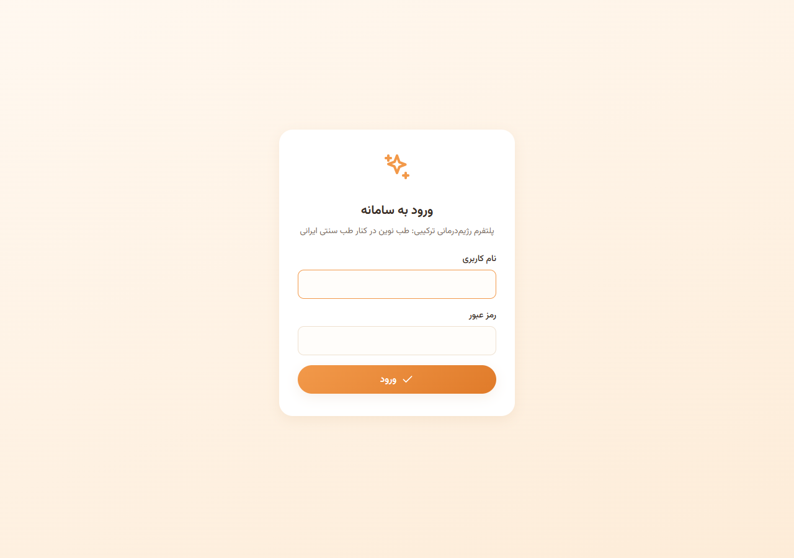 
  The only unauthenticated route in the app — everything else, including the first-run installer, sits behind this.

## Table of contents

- [Core features](#core-features)
  - [1. Onboarding & mizaj assessment](#1-onboarding--mizaj-assessment)
  - [2. Three-layer diet engine](#2-three-layer-diet-engine)
  - [3. Daily tracking & progress dashboard](#3-daily-tracking--progress-dashboard)
  - [4. Agentic AI nutrition assistant](#4-agentic-ai-nutrition-assistant)
  - [5. Document generation & file library](#5-document-generation--file-library)
  - [6. Multi-user accounts & security](#6-multi-user-accounts--security)
  - [7. Admin dashboard & token analytics](#7-admin-dashboard--token-analytics)
- [Architecture](#architecture)
- [Tech stack](#tech-stack)
- [Testing](#testing)
- [Deployment](#deployment)
- [Author](#author)

## Core features

### 1. Onboarding & mizaj assessment

A three-step wizard collects everything the engine needs: body metrics and medical history (allergies, conditions, dietary restrictions), a 14-question mizaj questionnaire (7 questions per axis — heat and moisture), and a weight goal. Every question carries a short, concrete guide explaining what to picture when answering (`"compare yourself to people around you in the same room"`, not abstract Likert-scale jargon), because a mistranslated or misunderstood temperament questionnaire produces a wrong diet, not just a wrong quiz score.

  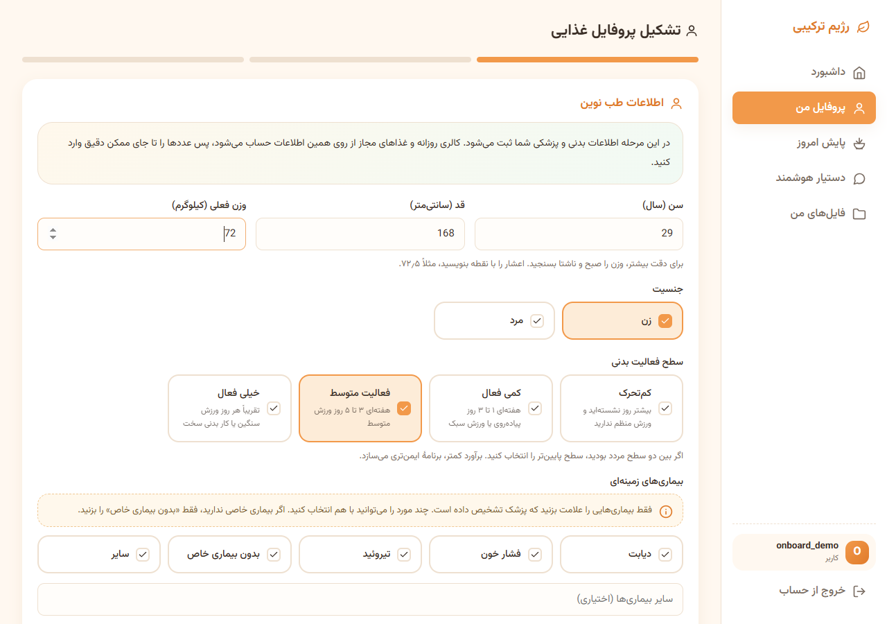 
  Step 1 — body metrics and medical history, with an inline guidance box.

  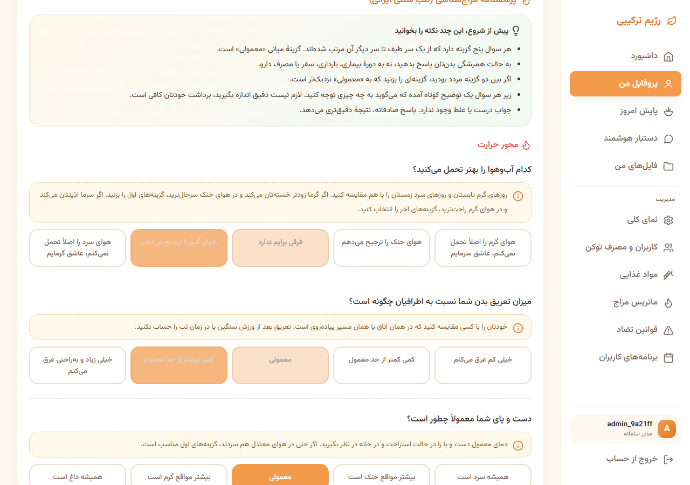 
  Step 2 — the mizaj questionnaire. Every one of the 14 questions has its own answer guide, plus an intro box explaining how to read the 5-point scale.

  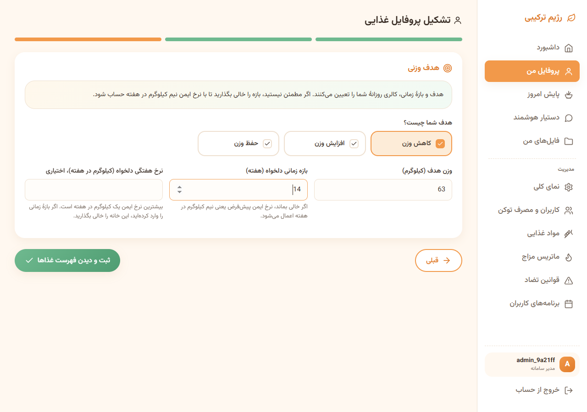 
  Step 3 — weight goal, timeframe or a target weekly rate (capped at a safe 1 kg/week).

The questionnaire scoring lives in `src/Services/MizajQuiz.php` and is documented in `docs/mizaj-scoring-algorithm.md`; it produces a heat score and a moisture score, each with an intensity label (mild/moderate/severe), which combine into one of nine temperament profiles (e.g. "warm-dry, moderate").

### 2. Three-layer diet engine

1. **Rule-based math** — Mifflin-St Jeor BMR, an activity-level TDEE multiplier, and a macro split derived from the user's goal (documented in `docs/engine-design.md`).
2. **Mizaj conflict filter** — every candidate food is checked against the user's temperament using an editable rules table (`mizaj_conflict_rules`): foods that would intensify a severe temperament trait are removed outright, moderate clashes are kept but flagged with a suggested *moseleh* to balance them. The reviewer step surfaces both explicitly so the user understands *why* a food was excluded or flagged, not just that it was.
3. **Weekly plan generation** — the surviving food list plus the user's targets are handed to GPT-4o-mini (via an OpenAI-compatible endpoint) to compose a full 7-day, 5-meals-a-day plan that hits the calorie target within ±10% per day, with no two days repeating the same food set. If the AI call fails or times out, a deterministic rule-based planner produces a full plan anyway — **the user never gets stuck with no plan.**

  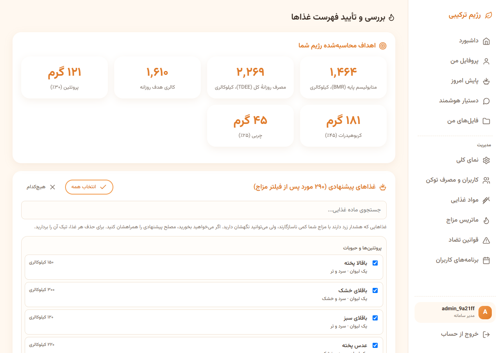 
  Reviewing the filtered food list — flagged items show their conflict reason and suggested moseleh; the user can still keep or drop them.

  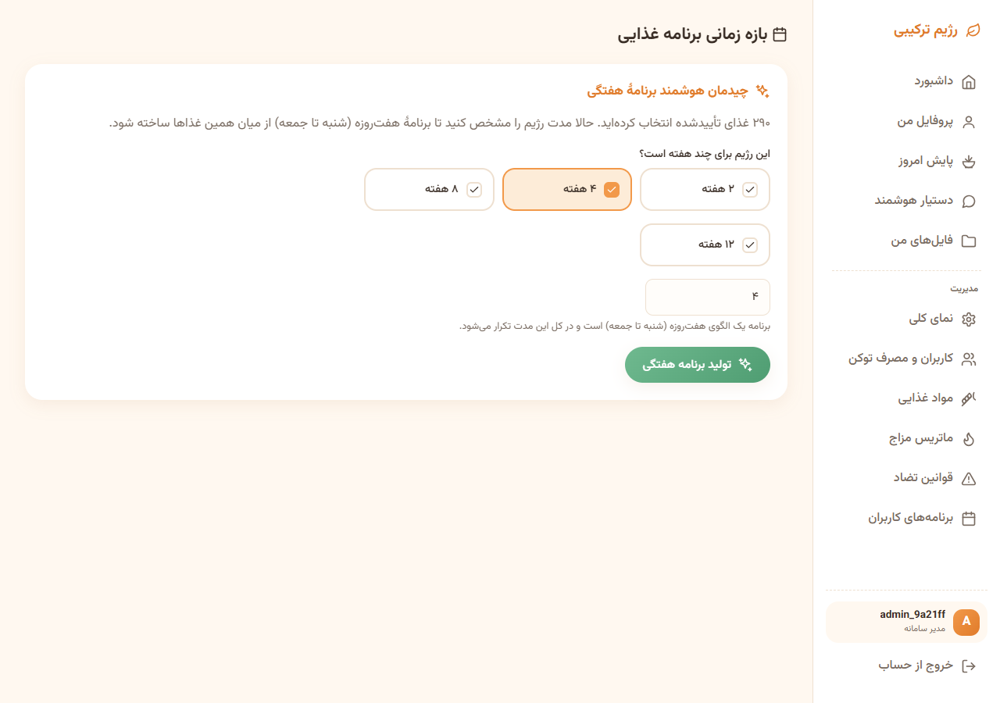 
  Choosing a plan duration before generation — the food list carried over from the review step is reused as-is.

  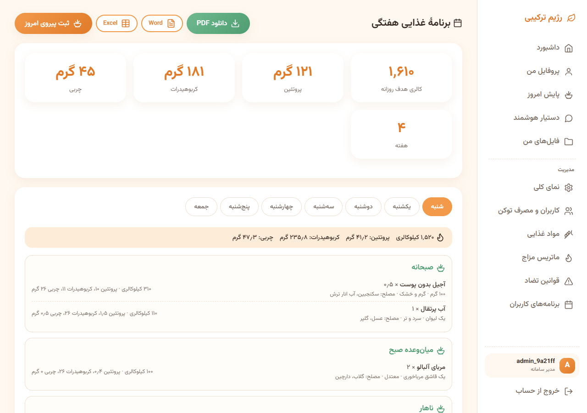 
  The generated weekly plan — full macro breakdown per meal, day-by-day tabs, and one-click PDF/Word/Excel export.

  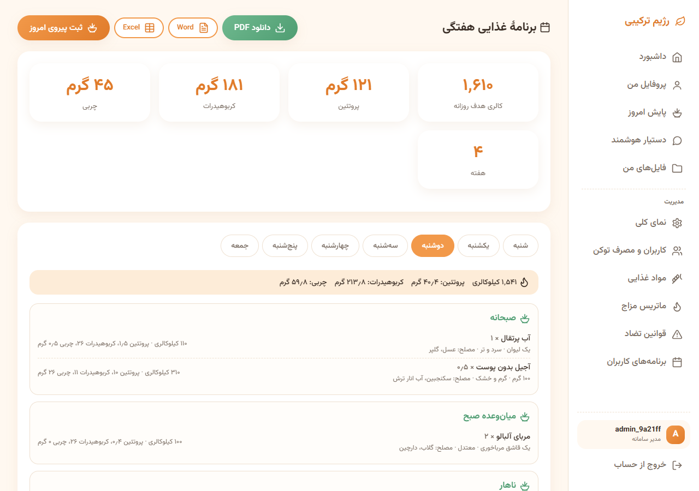 
  Per-meal detail: portion multipliers, exact macros per item, and the corrective ingredient for temperament-imbalanced foods.

### 3. Daily tracking & progress dashboard

A simple per-meal checklist (eaten / swapped / skipped), daily weight and mood logging, and a dashboard that turns that into an adherence percentage, a streak counter, a hand-drawn canvas weight trend chart with Jalali (Persian calendar) date labels, and progress toward the user's weight goal.

  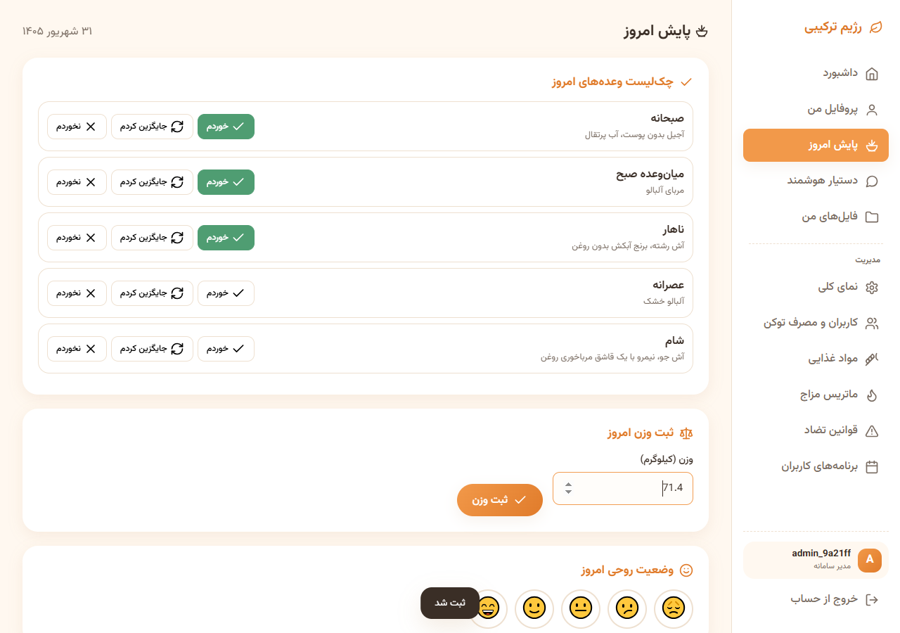 
  Daily tracking — per-meal status, today's weight entry, mood check-in.

  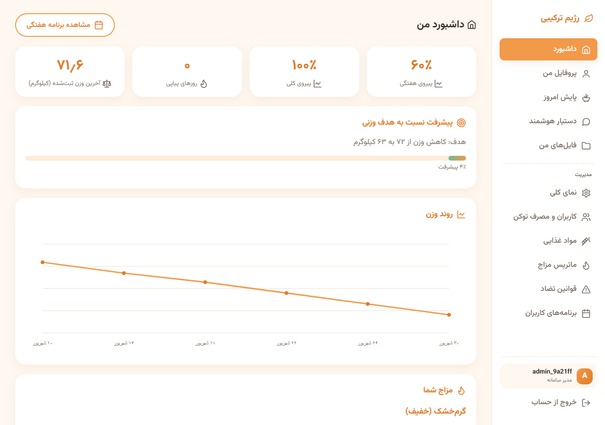 
  Dashboard — adherence, streak, a real weight trend rendered on canvas, and the user's mizaj summary.

### 4. Agentic AI nutrition assistant

This is the part of the project built around one hard constraint: **an AI chat feature wired to a database and a metered API is a liability if it isn't deliberately fenced in.** The assistant is a three-layer pipeline (`src/Services/Chat/ChatPipeline.php`), not a single prompt-and-respond loop:

- **Pre-retrieval** — trivial messages ("hi", "thanks") are routed without calling the model at all. Everything else goes through a cheap routing call that decides: quick reply or analytical reply, does this need the food database, does it need the user's current plan, is a file being requested (and in what format), and does this message contain a durable fact worth remembering about the user (e.g. "I don't like fish", "I usually eat dinner at 9pm"). The chosen mode is shown to the user live, next to the answer, as it's being decided.
- **Retrieval** — if the router says it needs data, a second model call writes one or two read-only `SELECT` statements against two dedicated database views. Before anything executes, a hand-written SQL parser (**not** a second LLM call — a deterministic tokenizer/validator, `src/Services/Chat/SqlGuard.php`) rejects anything that isn't a plain, single-statement `SELECT` against the allow-listed views, blocks every write/DDL keyword and dangerous function by name, and clamps `LIMIT`. What survives is then run inside a `SafeQueryRunner` that opens a **read-only transaction**, enforces a query timeout, and rolls back unconditionally — so even a validator bug can't let a write through. Every query, allowed or blocked, is logged.
- **Post-retrieval** — the assistant's answer streams to the browser token-by-token over Server-Sent Events as it's generated (with a working **stop** button that saves the partial answer), and if a file was requested, it's authored and attached to the same message after the text answer finishes.

  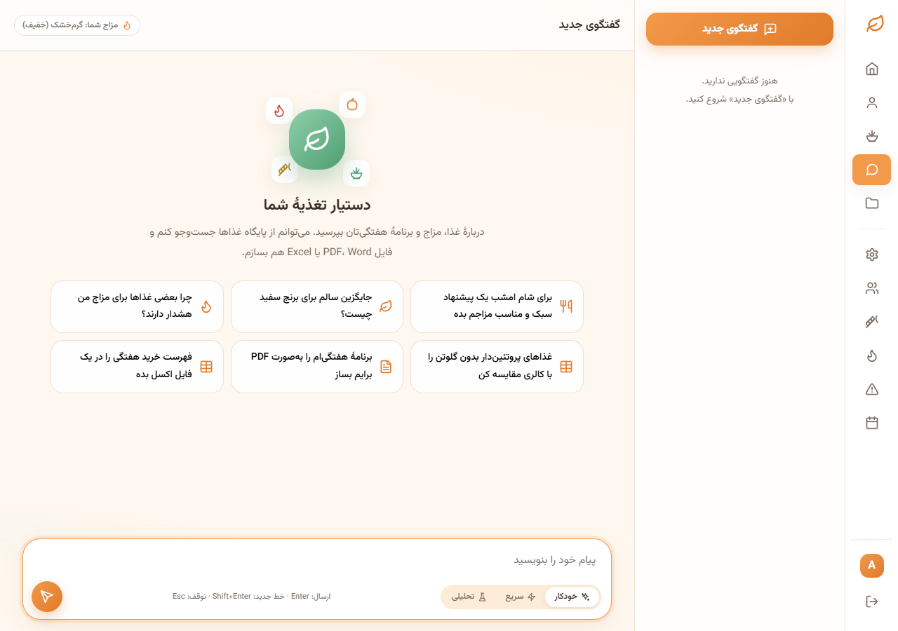 
  Empty state, with suggested prompts and a manual override for quick vs. analytical mode.

  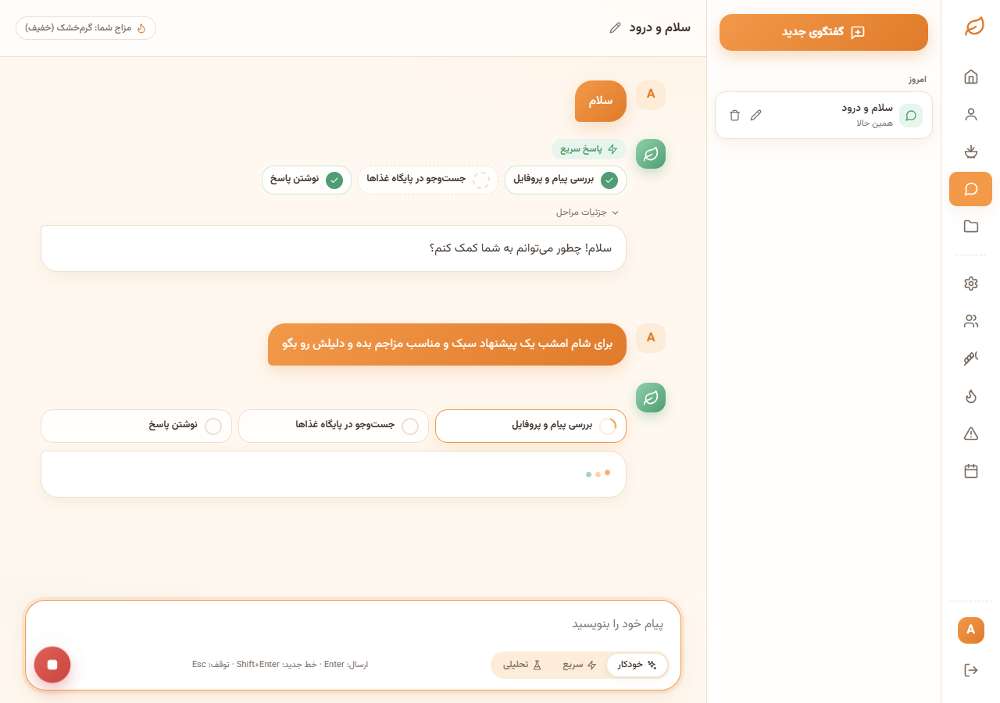 
  An analytical answer mid-stream — the three pipeline stages are shown live as they run, with a working stop button.

  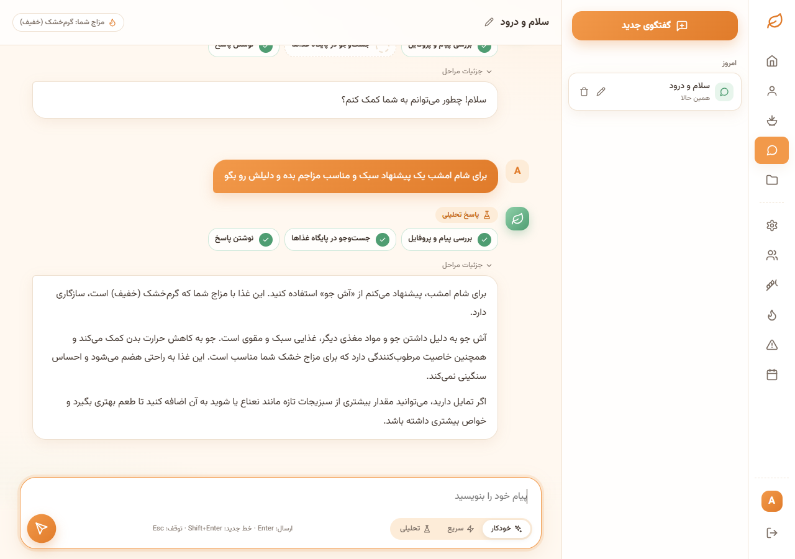 
  The finished answer: a recommendation pulled from the real food database, with mizaj-aware reasoning.

  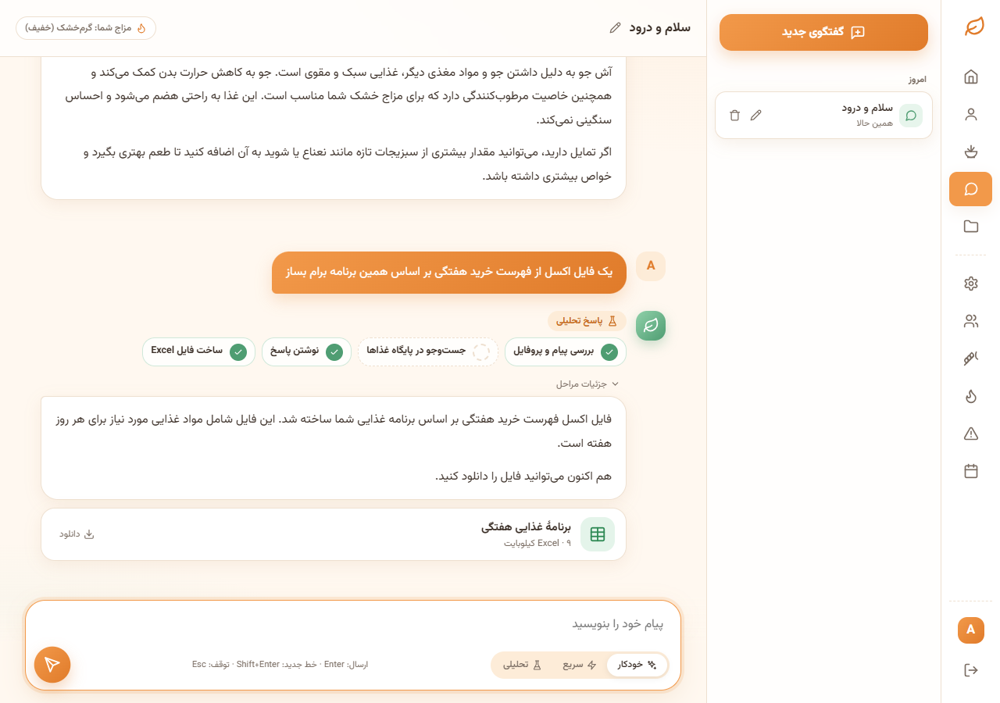 
  A file request handled end-to-end: the assistant explains what it made, then attaches a real, downloadable Excel file.

  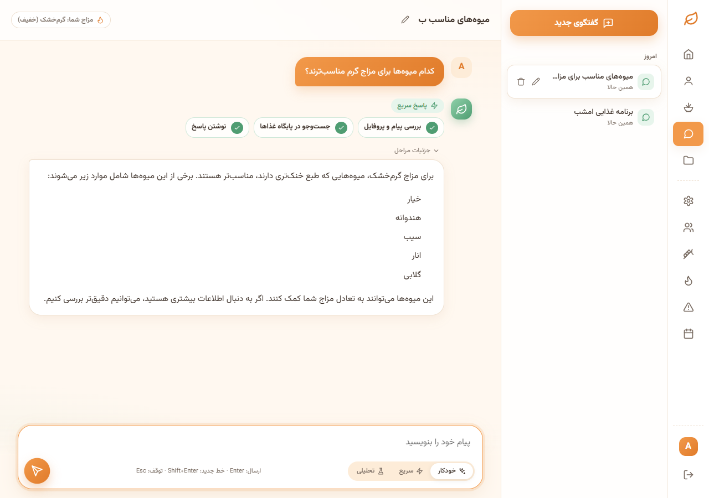 
  Multiple independent chat sessions per user, auto-titled from the first message and renameable.

  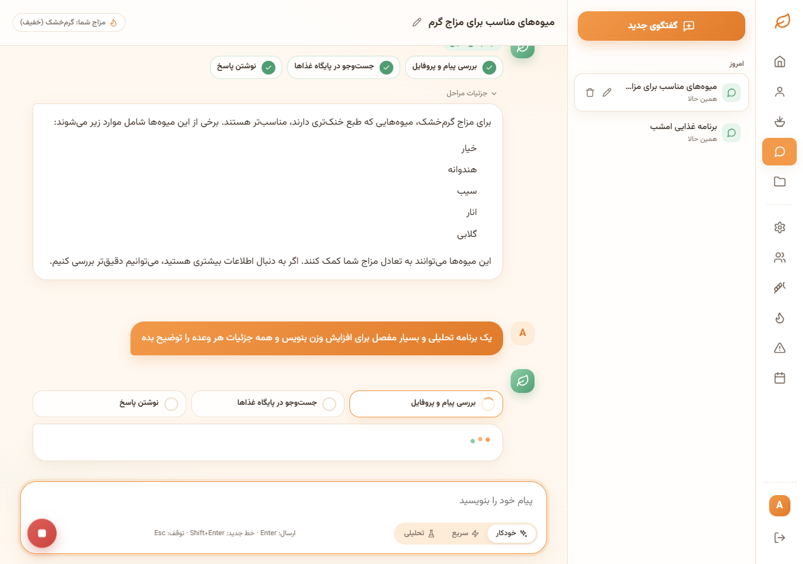 
  Stopping generation mid-stream — the partial answer and elapsed pipeline state are preserved.

  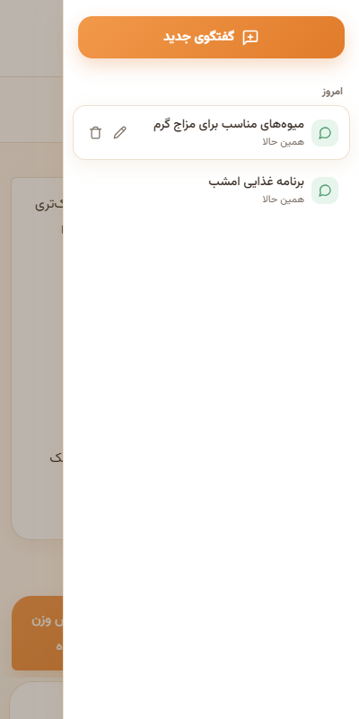 
  Responsive layout — the session list becomes a slide-out drawer on small screens.

### 5. Document generation & file library

The assistant (or the weekly-plan page directly) can produce **PDF, Word (.docx) and Excel (.xlsx)** files — a plan export, a shopping list, a comparison table, anything the conversation calls for. PDFs are rendered with an embedded Vazirmatn font for correct Persian typography; Word and Excel files are hand-written OOXML (no bulky templating library) with right-to-left paragraph direction, RTL sheet order, and proper table layout. Every generated file is stored as a database blob tied to its owner, so files survive a redeploy and are never mixed up between users.

  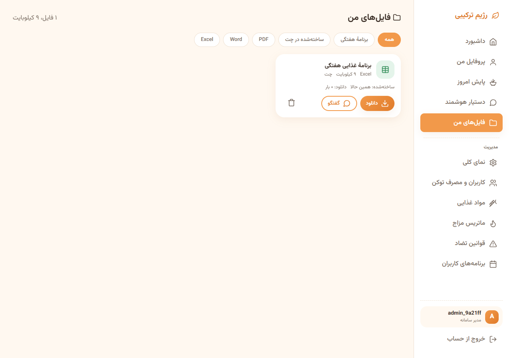 
  The file library — everything generated from chat or the plan page, filterable by format and source.

### 6. Multi-user accounts & security

Because every request in this app can trigger a metered AI call, **unauthenticated access is treated as a direct cost risk**, not just a privacy concern:

- The entire application — including the first-run installer — sits behind a login gate; nothing is reachable while signed out.
- CSRF tokens are required and verified on every `POST`, centrally, before any route handler runs.
- Failed logins are throttled per IP with a lockout window.
- Per-user rate limits cap chat messages and weekly-plan generations independently of any billing on the AI provider's side.
- Every repository method that reads or writes user-owned data (chats, files, plans, tracking logs) filters by the authenticated user's ID — verified with an automated test that a second user, admin included, gets a 404 from another user's data through every route, not just the obvious ones.
- Role-based access (`admin` / `user`) gates the entire `/admin` tree server-side, independent of anything the client sends.

### 7. Admin dashboard & token analytics

Every LLM call anywhere in the app — chat routing, SQL generation, the chat answer itself, file authoring, memory summarization, chat titling, and weekly-plan generation — is metered through one client and recorded with its feature name, model, prompt/completion token counts, and owning user. The admin panel turns that into a live connectivity check for the AI provider, per-feature usage bars, a 30-day usage chart, and a per-user breakdown, so whoever is paying the API bill can see exactly what's consuming it instead of finding out at the invoice.

  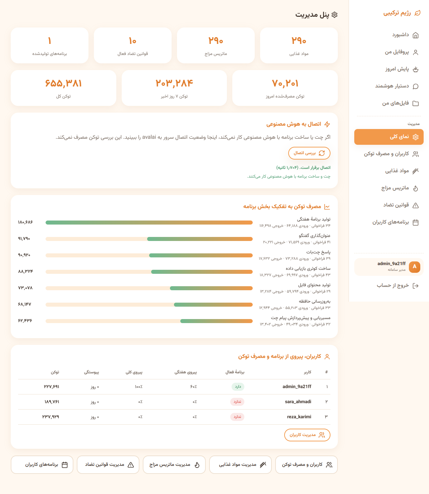 
  Admin dashboard — a one-click AI connectivity check (useful for diagnosing hosting/network issues without touching the API bill), per-feature token bars, and per-user totals.

  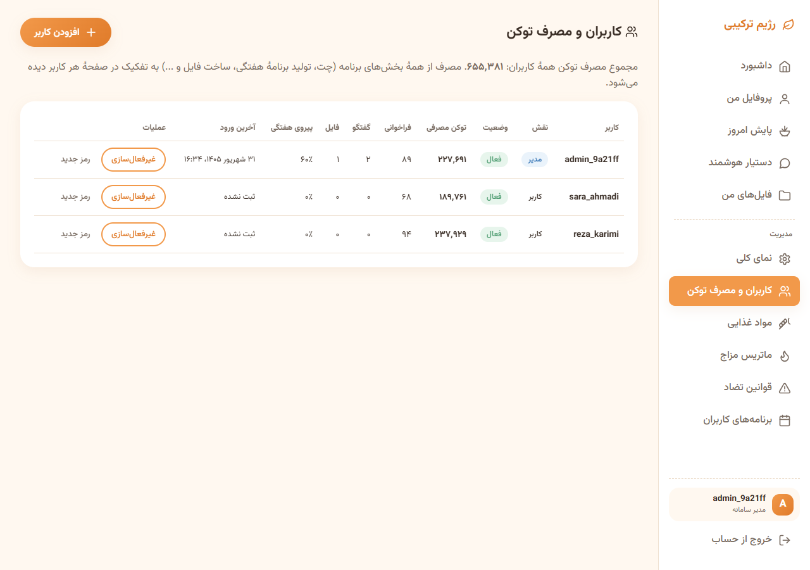 
  User management — create, deactivate, reset passwords, and see usage at a glance.

  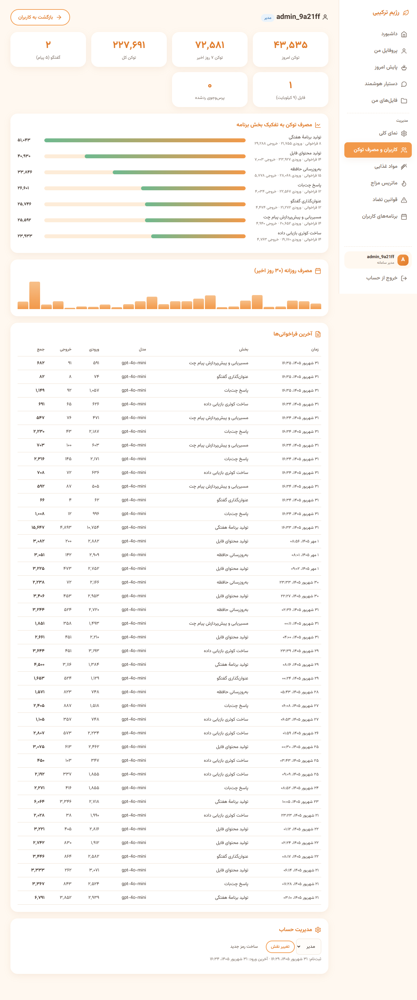 
  Per-user detail — a 30-day usage chart and a full log of individual AI calls with token counts.

  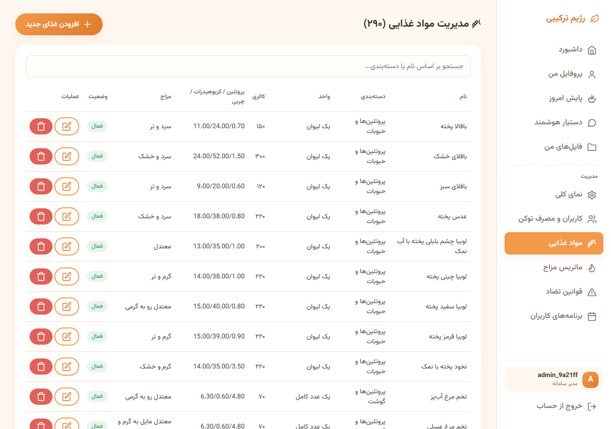 
  The 290-item food database — fully editable, each item classified by calories, macros and mizaj.

  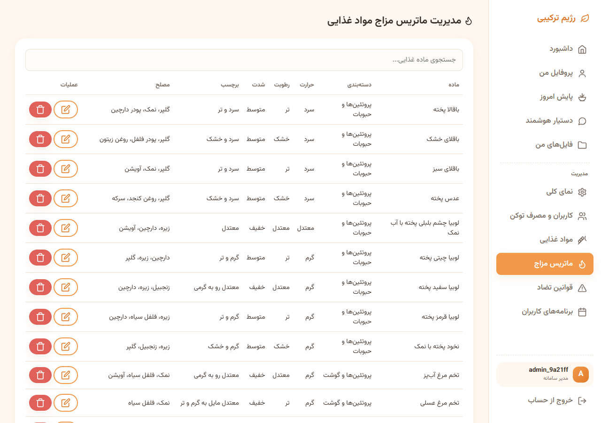 
  The mizaj matrix — heat/moisture/intensity classification and suggested moseleh per food, independent of the base food record.

  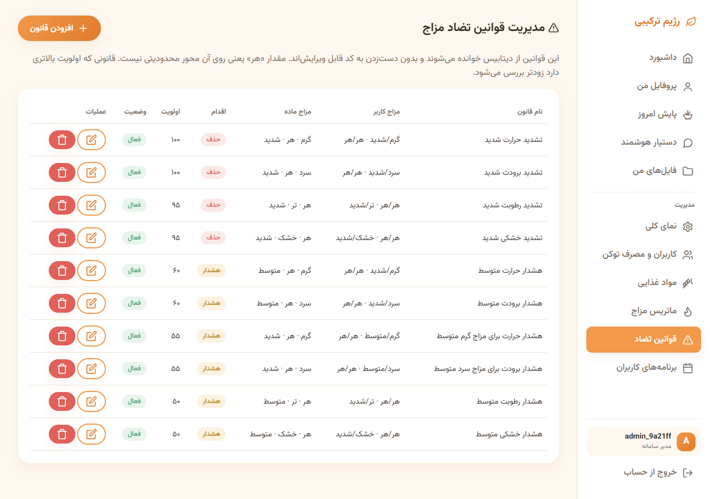 
  Conflict rules — the logic that removes or flags foods for a given temperament is entirely data-driven and editable here, not hardcoded.

  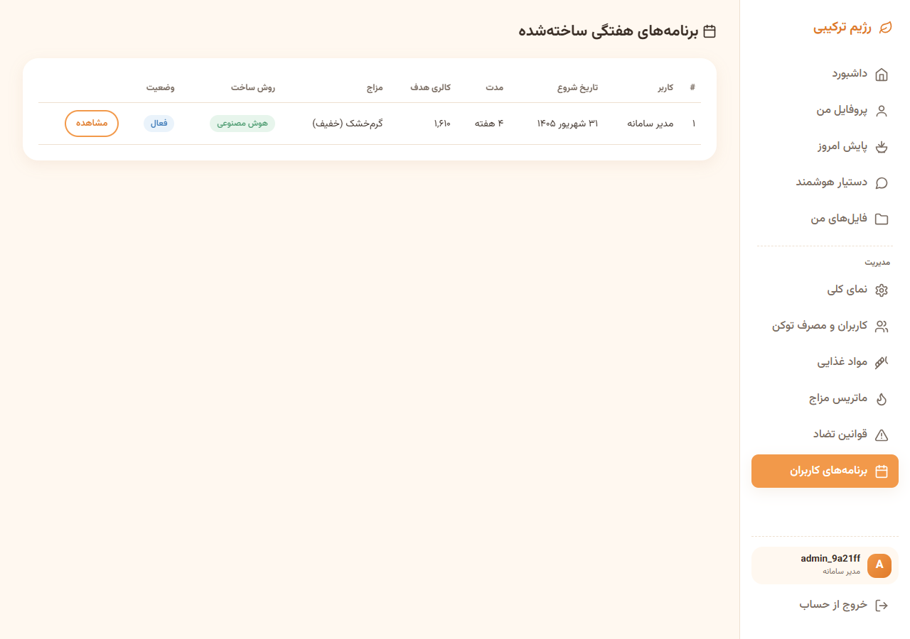 
  Every plan ever generated, across all users, with whether it was AI-composed or the rule-based fallback.

## Architecture

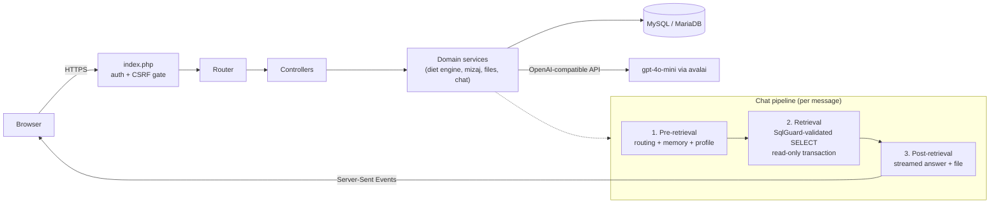

Everything runs as a dependency-light, no-build-step PHP application: a minimal router, PDO for the database layer, server-rendered views, and vanilla JS on the client (no bundler, no framework). The only third-party library shipped is mPDF, for PDF rendering.

## Tech stack

| Layer | Choice |
|---|---|
| Language / runtime | PHP 8.1+ |
| Database | MySQL 8 (MariaDB 10.4+ compatible) via PDO |
| AI | GPT-4o-mini through an OpenAI-compatible endpoint, streamed via SSE |
| PDF generation | [mPDF](https://mpdf.github.io/) with an embedded Vazirmatn font |
| Word / Excel generation | Hand-written OOXML (`ZipArchive`), no templating library |
| Frontend | Vanilla JS, CSS custom properties, RTL-first, self-hosted Vazirmatn |
| Auth | PHP native sessions, CSRF tokens, bcrypt, IP-based login throttling |

## Testing

The private repository ships automated suites for the parts that matter most: 76 cases for the SQL allow-list/deny-list,
a test proving the read-only transaction really blocks writes, PDF/Word/Excel generation and storage round-trips,
fresh-install and upgrade migrations, the full three-layer chat pipeline against the real model, and a multi-user HTTP
flow covering data isolation, CSRF, rate limits, streaming and file downloads.

## Deployment

Built to run on a plain shared cPanel host with no SSH or Composer: dependencies ship with the app, and a
browser-based installer creates the schema and seeds the 290-item food database on first run.

## Author

**Alireza Eram** ([@reza1eram](https://github.com/reza1eram))

The source code is private. For questions or collaboration, contact me through GitHub.
